  

  
  
  

## About

Data Analyst focused on **sales, supply chain and operations analytics**. I work with SQL, Power BI, Excel, Python and DAX to turn raw data into clear, decision-ready insight. This profile documents my projects and the skills behind them.

## Skills

| Area | Tools and methods |
|---|---|
| **Business intelligence** |     |
| **Querying and programming** |     |
| **Analysis methods** | Exploratory data analysis, KPI design, data modelling, trend and variance analysis, A/B testing (learning) |
| **Workflow** |   |

## How I work

## Projects

<!--START_PROJECTS-->
| Project | Business question | Tools | Status |
|---|---|---|---|
| [**Sales Performance Dashboard**](https://github.com/sonusinhadata/sales-performance-dashboard) | Which regions, products and reps drive revenue? | Power BI, DAX, Excel |  |
| [**Supply Chain Stock-out Analysis**](https://github.com/sonusinhadata/supply-chain-stockout-analysis) | Where and why do stock-outs and delays occur? | SQL, Python, Pandas |  |
| [**Operations OTIF Tracker**](https://github.com/sonusinhadata/operations-otif-tracker) | How often are orders delivered on time and in full? | Power Query, Power BI |  |
<!--END_PROJECTS-->

## Learning roadmap

<!--START_ROADMAP-->
- [x] Excel: pivots, XLOOKUP, dashboards
- [x] SQL fundamentals: SELECT, JOIN, GROUP BY
- [ ] SQL advanced: CTEs, window functions
- [ ] Python: Pandas, NumPy, Matplotlib
- [ ] Power BI and DAX
- [ ] Statistics and A/B testing
- [ ] Capstone project
<!--END_ROADMAP-->

## GitHub activity

  
  

## Contact

Open to **Data Analyst** opportunities. Reach me on [LinkedIn](https://www.linkedin.com/in/sonusinha-dataanalyst) or at sonusinha.data@gmail.com.
