<h3><code>sonu@github ~ $ ./contributions.sh</code></h3>

  

<h3><code>sonu@github ~ $ whoami</code></h3>

<table align="center">
<tr>

<td align="center" valign="middle" width="470">

</td>

<td align="center" valign="middle" width="500">

</td>

</tr>
</table>

